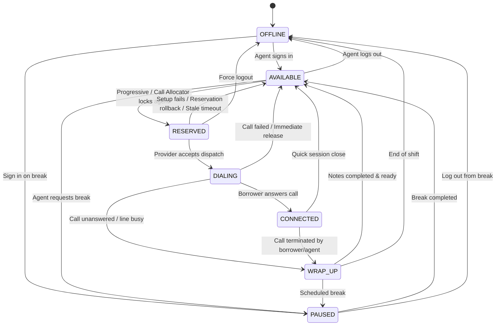

# Agent State Machine Specification

SmartDialer implements a deterministic finite state machine (FSM) for agent availability and call lifecycle participation.

---

## 1. State Transition Diagram



---

## 2. State Definitions

| State | Description | Can Receive Inbound/Dial Call? | Concurrency Lock |
| :--- | :--- | :---: | :---: |
| **OFFLINE** | Agent is disconnected or signed off. | No | None |
| **AVAILABLE** | Agent is ready to accept a call reservation. | **Yes** | None |
| **RESERVED** | Agent is locked for an in-flight call setup. | No | **Locked** (has `reserved_at` timestamp) |
| **DIALING** | Gateway is actively ringing the borrower line. | No | **Locked** (has `current_call_id`) |
| **CONNECTED** | Agent is actively speaking with borrower. | No | **Locked** (has `current_call_id`) |
| **WRAP_UP** | Call has ended; agent is documenting disposition. | No | **Locked** |
| **PAUSED** | Agent is temporarily away (break, training). | No | None |

---

## 3. Allowed Transition Matrix

| Current State | Permitted Next States |
| :--- | :--- |
| `OFFLINE` | `AVAILABLE`, `PAUSED` |
| `AVAILABLE` | `RESERVED`, `PAUSED`, `OFFLINE` |
| `RESERVED` | `DIALING`, `AVAILABLE` (on rollback), `OFFLINE` |
| `DIALING` | `CONNECTED`, `WRAP_UP`, `AVAILABLE` (on failure), `OFFLINE` |
| `CONNECTED` | `WRAP_UP`, `AVAILABLE`, `OFFLINE` |
| `WRAP_UP` | `AVAILABLE`, `PAUSED`, `OFFLINE` |
| `PAUSED` | `AVAILABLE`, `OFFLINE` |

Any attempt to transition outside this matrix raises an `HTTP 400 Bad Request: Invalid agent status transition`.

---

## 4. Concurrency & Safety Controls

1. **Conditional Reservation**:
   Agents are reserved using database-level conditional updates:
   ```sql
   UPDATE agents 
   SET status = 'RESERVED', reserved_at = CURRENT_TIMESTAMP 
   WHERE id = :agent_id AND status = 'AVAILABLE';
   ```
   If `rowcount == 0`, another worker grabbed the agent, preventing double allocation.

2. **Automated Stale Recovery**:
   If an agent remains in `RESERVED` status for longer than 45 seconds without an active linked call (e.g., due to a worker crash or unhandled gateway exception), the recovery sweeper safely resets the agent to `AVAILABLE`.
