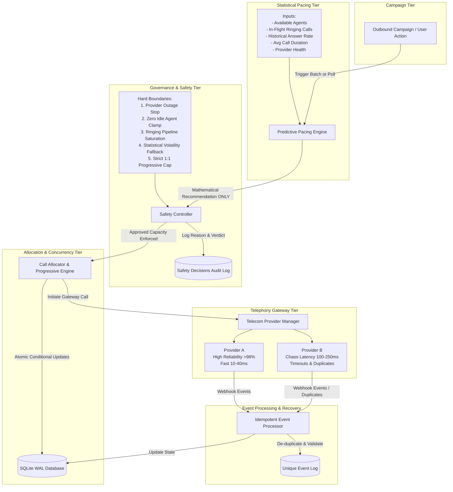

# SmartDialer Architecture Specification

SmartDialer implements a modern, fault-tolerant telephony dialing architecture modeled after enterprise contact-center platforms. The platform separates statistical forecasting from safety authorization and allocation execution.

---

## 1. End-to-End Pipeline



---

## 2. Component Responsibilities

### A. Campaign & User Operations
- Initiates progressive batch runs or automated continuous campaign cycles.
- Manages queue prioritization of borrowers (Tier 1 Urgent through Tier 5 Standard).

### B. Predictive Pacing Engine
- **Sole Responsibility**: Pure mathematical calculation of proposed outbound call volume.
- **Inputs**:
  - Available agents ($A_{\text{avail}}$)
  - Reserved agents ($A_{\text{res}}$)
  - Active in-call agents ($N_{\text{active}}$)
  - Dispatched in-flight ringing calls ($N_{\text{ring}}$)
  - Historical answer rate ($r_{\text{ans}}$)
  - Average call duration ($T_{\text{dur}}$)
  - Telecom provider health status ($H_{\text{prov}}$)
- **CRITICAL INVARIANT**: The predictive engine **NEVER** communicates directly with the telephony gateway or directly creates calls. It only yields recommendation proposals.

### C. Safety Controller
- Sits as the authoritative gatekeeper between recommendation and dispatch.
- **Hard Safety Guarantees**:
  - **Zero Abandonment Target**: Never permits calls to exceed available capacity if the probability of concurrent answers exceeds safe bounds.
  - **Provider Outage Stop**: Immediately halts all dialing when telecom gateways experience outages.
  - **Progressive Fallback**: Automatically reverts from predictive dialing to conservative 1:1 progressive dialing when answer rates exceed 60% or when the agent pool drops below 3 agents (where Poisson statistical smoothing breaks down).
  - **Audit Immutability**: Every approved, reduced, or rejected batch is persisted in `safety_decisions` with its rule and justification.

### D. Call Allocator & Progressive Engine
- Executes 1:1 atomic reservation of agent and borrower using conditional SQL updates:
  ```sql
  UPDATE agents SET status='RESERVED', reserved_at=:now WHERE id=:agent_id AND status='AVAILABLE';
  UPDATE borrowers SET call_status='CALLING', attempt_count=attempt_count+1 WHERE id=:borrower_id AND call_status='UNPROCESSED';
  ```
- Protects against multi-worker race conditions with transaction-safe locks.
- If telephony gateway dispatch fails, agent reservation is automatically rolled back to `AVAILABLE`.

### E. Mock Telecom Gateways (Provider A & Provider B)
- Shared `BaseTelecomProvider` interface.
- **Provider A**: Emulates carrier-grade tier-1 trunks with fast 10-40ms latency and high reliability (>98%).
- **Provider B**: Emulates volatile trunks with configurable latency (100-250ms), timeouts (504), carrier errors (503), duplicate webhooks, and out-of-order sequence delivery.

### F. Idempotent Event Processor & Failure Recovery
- **Unique Event Deduplication**: Ingests provider event IDs and ignores duplicates.
- **Terminal State Lock**: Calls in `COMPLETED`, `FAILED`, or `CANCELLED` are immutable; late events can never reopen them.
- **Sequence Protection**: Rejects out-of-order events where event rank is lower than the call's current rank.
- **Stale Reservation Recovery**: Background sweeper detects reservations held longer than timeout threshold (e.g. 45s) without active calls and returns agents to `AVAILABLE`.
