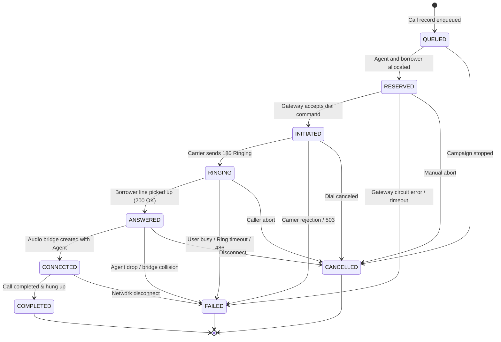

# Call State Machine Specification

SmartDialer implements a strict, unidirectional state machine governing telephony call sessions.

---

## 1. State Transition Diagram

---

## 2. State Definitions

| State | Category | Description | Agent Status |
| :--- | :--- | :--- | :--- |
| **QUEUED** | Pre-Call | Call request waiting for agent & borrower pairing. | N/A |
| **RESERVED** | Pre-Call | Borrower & Agent reserved in database; ready to dial. | `RESERVED` |
| **INITIATED** | In-Flight | Telephony gateway accepted dial command. | `DIALING` |
| **RINGING** | In-Flight | Carrier signaling that borrower device is ringing. | `DIALING` |
| **ANSWERED** | In-Flight | Borrower picked up; telephony bridge connecting. | `DIALING` / `CONNECTED` |
| **CONNECTED** | Active | Two-way audio conversation active. | `CONNECTED` |
| **COMPLETED** | **Terminal** | Call concluded normally; duration recorded. | `WRAP_UP` / `AVAILABLE` |
| **FAILED** | **Terminal** | Carrier error, timeout, busy, or unallocated line. | Released to `AVAILABLE` |
| **CANCELLED** | **Terminal** | Call canceled by operator or campaign shutdown. | Released to `AVAILABLE` |

---

## 3. Allowed Transition Table

| Source State | Permitted Destination States |
| :--- | :--- |
| `QUEUED` | `RESERVED`, `CANCELLED` |
| `RESERVED` | `INITIATED`, `CANCELLED`, `FAILED` |
| `INITIATED` | `RINGING`, `FAILED`, `CANCELLED` |
| `RINGING` | `ANSWERED`, `FAILED`, `CANCELLED` |
| `ANSWERED` | `CONNECTED`, `FAILED`, `CANCELLED` |
| `CONNECTED` | `COMPLETED`, `FAILED` |
| `COMPLETED` | **None** (Terminal & Immutable) |
| `FAILED` | **None** (Terminal & Immutable) |
| `CANCELLED` | **None** (Terminal & Immutable) |

---

## 4. Critical Invariants

### 1. Terminal State Immutability
Once a call reaches `COMPLETED`, `FAILED`, or `CANCELLED`, it enters an irreversible terminal state. Late-arriving provider webhook events (e.g. late `RINGING` or `ANSWERED` signals from Provider B) are logged into the audit table with status `IGNORED_CALL_TERMINAL` and **never** move the call back into an active state.

### 2. Sequence Validation
Every webhook event includes an incrementing sequence number. If a lower-ranked event arrives after a higher-ranked event (e.g. `INITIATED` arriving after `CONNECTED`), the Event Processor flags it as `IGNORED_OUT_OF_ORDER`.

### 3. Agent Release Guarantee
If a call enters `FAILED` or `CANCELLED`, the linked agent is immediately released back to `AVAILABLE`. This guarantees that telephony carrier errors never lock agents indefinitely.
